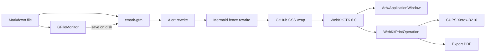
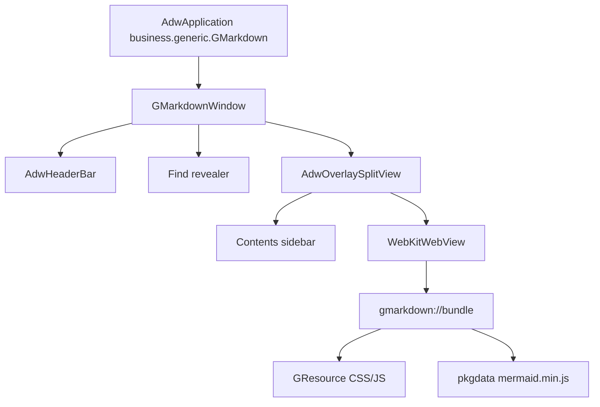
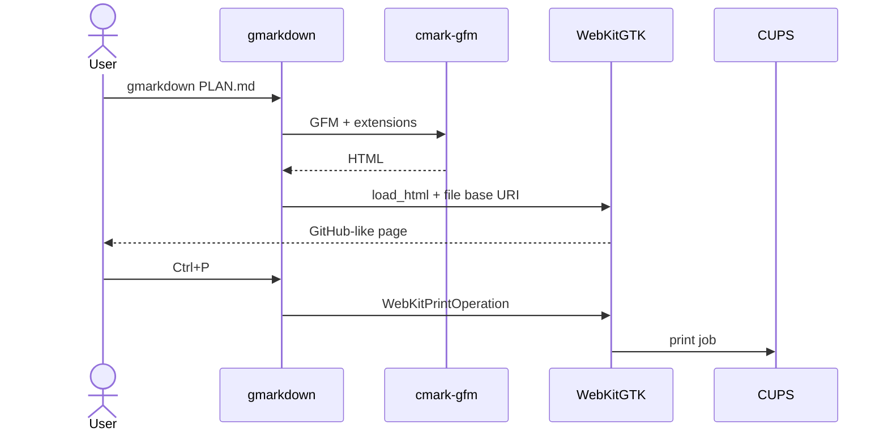
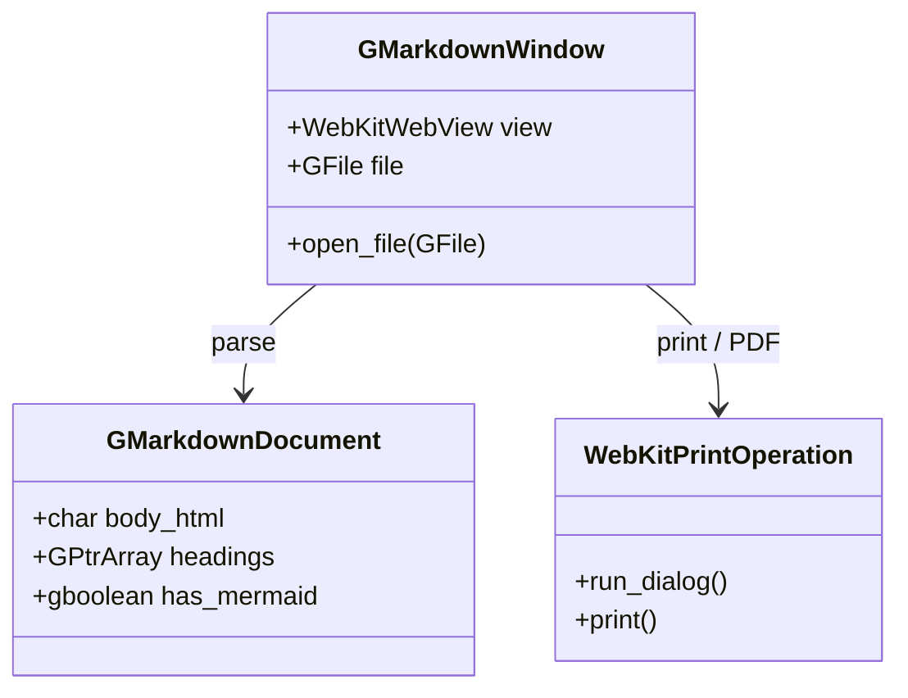
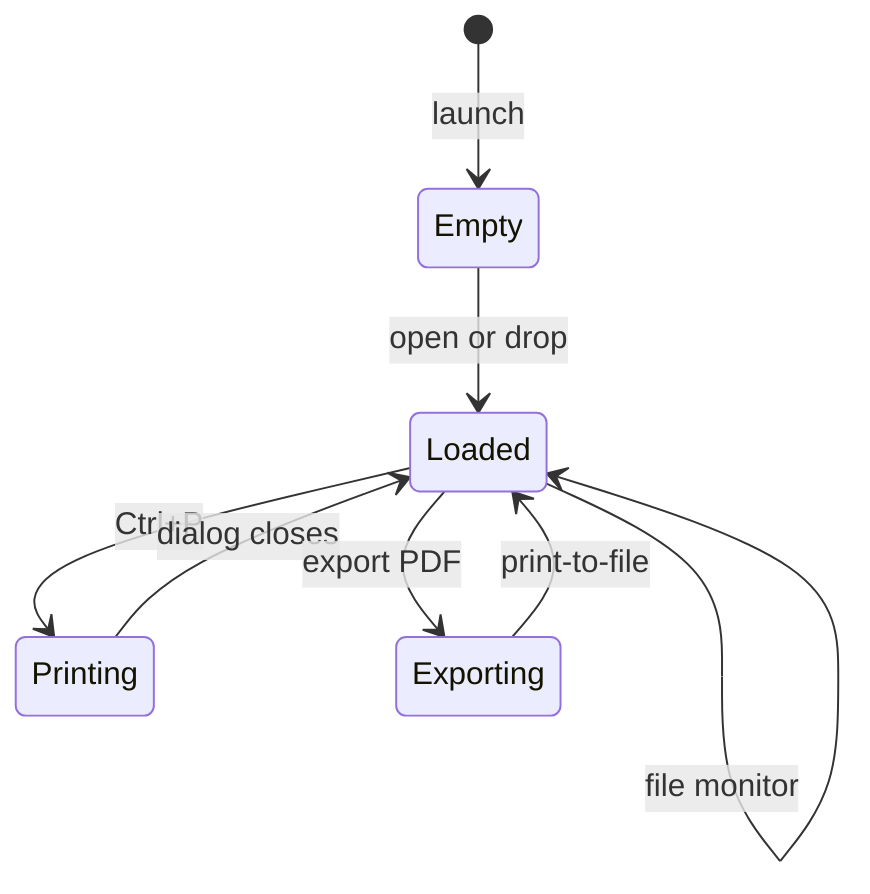
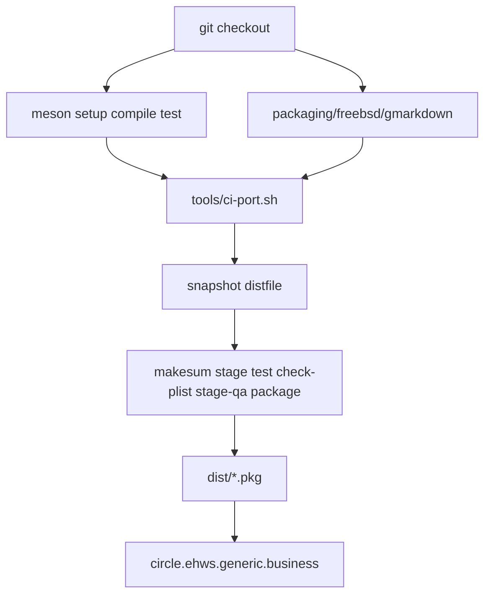
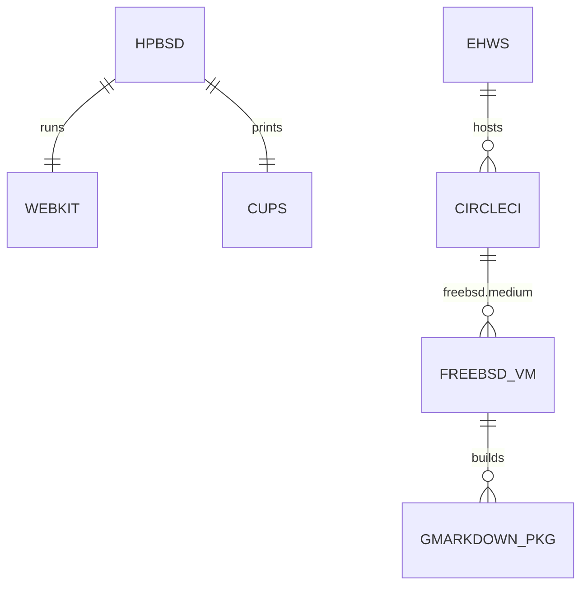
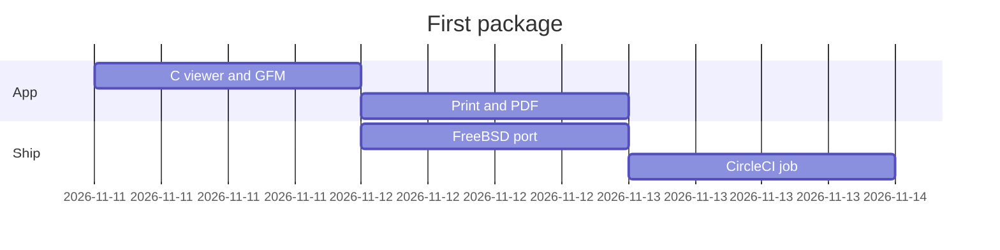
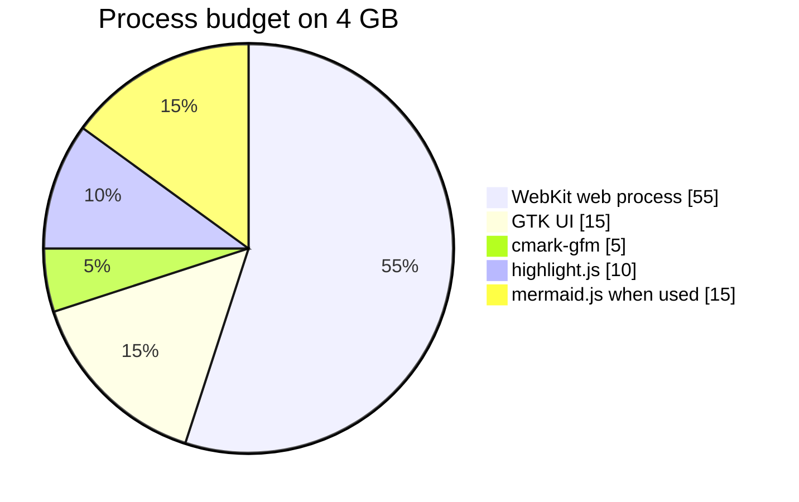

# GMarkdown

A GTK4 / libadwaita Markdown **viewer** for FreeBSD GNOME. It is not an editor. Open a `.md` file and read it the way GitHub would, then print or export a PDF.

This document is the design **and** the capability test. Open it with:

```sh
gmarkdown PLAN.md
```

App id: `business.generic.GMarkdown`  
Binary: `gmarkdown`  
Homepage: <https://generic.business>

> [!NOTE]
> Reverse-DNS of **generic.business**, not incoherency.net.

> [!TIP]
> On hpbsd, WebKit needs `WEBKIT_DISABLE_COMPOSITING_MODE=1`. The app sets that unless it is already in the environment.

> [!WARNING]
> The N150 laptop has 4 GB RAM. One WebView, no extra browser, no network inside the page.

> [!IMPORTANT]
> CircleCI on EhWS builds the `.pkg`. Local meson must already compile and pass `meson test`.

> [!CAUTION]
> Do not compile WebKit in CI. Fetch `webkit2-gtk@60` from official latest.

---

## Why this stack

GitHub Flavored Markdown is defined by **cmark-gfm**. The page is HTML plus GitHub-like CSS, shown in the same **WebKitGTK 6.0** engine already on hpbsd (`webkit2-gtk_60` 2.46, GTK 4.20, libadwaita 1.8). Print goes through `WebKitPrintOperation` into CUPS (Xerox B210 in the lab).

| Piece | Choice | Why |
| --- | --- | --- |
| Language | C11 | Matches bsd-cubed / native WebKit probes |
| UI | GTK4 + libadwaita | GNOME 49 on hpbsd |
| Engine | webkitgtk-6.0 | Same as Epiphany on this system |
| Parser | cmark-gfm | GitHub's fork, not stock cmark |
| Diagrams | mermaid.min.js | GitHub ` ```mermaid ` fences |
| Highlight | highlight.js | GitHub light/dark themes |
| Package | `deskutils/gmarkdown` | bsd-cubed overlay style |
| CI | `freebsd.medium` | EhWS KubeVirt, not poudriere |

- [x] GFM tables, task lists, strikethrough, autolink, tagfilter
- [x] Footnotes and GitHub alerts
- [x] Mermaid fences
- [x] Print and export PDF
- [ ] Math / KaTeX (out of v1)
- [ ] In-place editing
- [ ] Flatpak

Hello **bold**, *italic*, ~~strikethrough~~, `inline code`, and a link to [generic.business](https://generic.business).

Autolink: https://circle.ehws.generic.business

---

## Pipeline



Relative images resolve against the file directory (`file:` base URI). `http(s)` and `mailto:` clicks leave the WebView through `GtkUriLauncher`.

---

## Application layout



Keyboard: <kbd>Ctrl</kbd>+<kbd>O</kbd> open, <kbd>Ctrl</kbd>+<kbd>F</kbd> find, <kbd>F9</kbd> contents, <kbd>Ctrl</kbd>+<kbd>P</kbd> print, <kbd>Ctrl</kbd>+<kbd>Shift</kbd>+<kbd>P</kbd> export PDF, zoom with <kbd>Ctrl</kbd>+<kbd>+</kbd> / <kbd>-</kbd> / <kbd>0</kbd>.

Drop a `.md` file on the window. Save it in another editor and the view reloads.

---

## GitHub-flavored details

cmark-gfm options: footnotes, GitHub info strings on code fences, smart punctuation, UTF-8 validation. Extensions: table, strikethrough, autolink, tagfilter, tasklist.

Alerts are GFM blockquotes starting with `[!NOTE]` and friends; we rewrite those into `.markdown-alert` nodes after HTML render.

Heading ids follow GitHub slugs so the contents sidebar can `scrollIntoView`.

```c
int
options(void)
{
	return (CMARK_OPT_FOOTNOTES |
	    CMARK_OPT_GITHUB_PRE_LANG |
	    CMARK_OPT_SMART);
}
```

```python
def greet(name: str) -> str:
    return f"hello {name}"
```

```js
mermaid.initialize({ startOnLoad: false, securityLevel: "strict" });
```

A footnote with a longer body.[^hpbsd]

[^hpbsd]: hpbsd is the HP N150 laptop running FreeBSD 15 and GNOME 49. Lab notes live in `hpbsd-lab`, not a `~/Projects/hpbsd` tree.

---

## Sequence: open a file



---

## Class sketch



---

## State: viewing



---

## Packaging and CI



CI machine: image `freebsd-15.1:current`, class `freebsd.medium`. Fetch gtk4, libadwaita, webkit2-gtk@60, cmark-gfm from official latest. Do **not** publish automatically to `packages.ehws.generic.business`.

ER of the lab pieces this app cares about:



---

## Gantt (build, not a product roadmap)



---

## What v1 refuses to be



Mermaid loads **only** when the document contains a mermaid fence, so ordinary README files stay lighter.

---

## License

BSD-2-Clause for GMarkdown. Vendored cmark-gfm, highlight.js, and mermaid keep their upstream licenses; see `THIRD_PARTY.md`.
