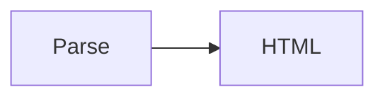

# Fixture

> [!NOTE]
> Alerts should render.

- [x] Task done
- [ ] Task open

| Col | Val |
| --- | --- |
| A | 1 |

```c
int main(void) { return 0; }
```



Hello **world** and ~~strike~~.

Footnote.[^1]

[^1]: Footnote body.
